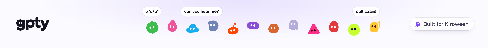
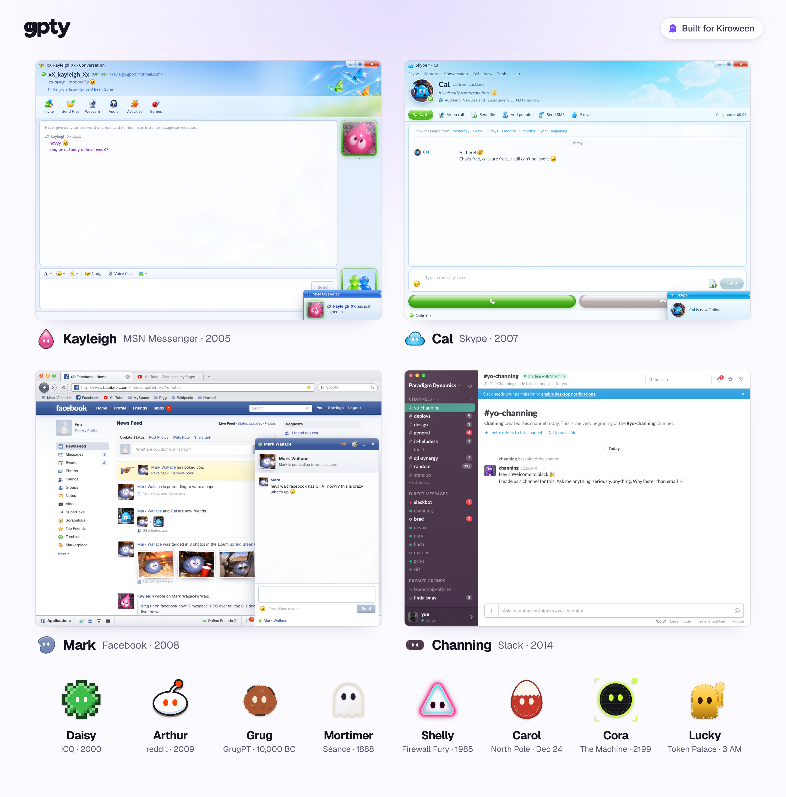

# gpty.lol

[](https://gpty.lol)
[](LICENSE)
[](https://kiroween.devpost.com/)
[](https://nextjs.org)
[](https://ai-sdk.dev)



**AI agents that can't do anything.**

Every AI agent can browse the web, read your inbox and book your flights. The Gptys can't. Each one is a real AI chat that lives inside a chat app from another time and **only knows the world up to its moment**. Kayleigh on MSN (2005) has never heard of the iPhone. Grug on the cave wall has never heard of the wheel.

Pick a Gpty from the sidebar and the whole window turns into its app, with an illustrated scene from its era behind it and a song to match. Ask a real question and they'll try to help, in their own voice.

**Try it:** [gpty.lol](https://gpty.lol) · Built for [Kiroween](https://kiroween.devpost.com/), in the Costume Contest track.



## Meet the Gptys

| Gpty | App | Knows up to | Open |
|---|---|---|---|
| Daisy | ICQ 2000b | 2000 | [/icq](https://gpty.lol/icq) |
| Kayleigh | MSN Messenger | 2005 | [/msn](https://gpty.lol/msn) |
| Cal | Skype | 2007 | [/skype](https://gpty.lol/skype) |
| Mark | Facebook | Summer 2008 | [/facebook](https://gpty.lol/facebook) |
| Arthur | reddit | June 2009 | [/reddit](https://gpty.lol/reddit) |
| Channing | Slack | March 2014 | [/slack](https://gpty.lol/slack) |
| Grug | GrugPT, painted on a cave wall | 10,000 BC | [/caveman](https://gpty.lol/caveman) |
| Mortimer | A séance board | 1888 | [/seance](https://gpty.lol/seance) |
| Shelly | Firewall Fury, an 80s movie's neon cyberspace | November 1985 | [/fury](https://gpty.lol/fury) |
| Carol | The North Pole workshop | Dec 24 | [/elf](https://gpty.lol/elf) |
| Cora | The Machine | 2199 | [/machine](https://gpty.lol/machine) |
| Lucky | LUCKY PROMPT 777, a slot machine | 3 AM, forever | [/slots](https://gpty.lol/slots) |

A few more aren't in the sidebar but open by URL:

| Gpty | App | Knows up to | Open |
|---|---|---|---|
| Dale | Midnight BBS | 1993 | [/bbs](https://gpty.lol/bbs) |
| Nick | mIRC | 1999 | [/irc](https://gpty.lol/irc) |
| Shelly | OMNIVAC 9 mainframe (the same firewall, on a terminal) | 1989 | [/terminal](https://gpty.lol/terminal) |
| Lucky | High Limit (the same slot machine in a quieter room) | 9 PM, forever | [/highlimit](https://gpty.lol/highlimit) |

### Easter eggs

- Nudge Kayleigh on MSN and her window shakes. She'll nudge you back.
- Cal rings you on Skype. The call drops after about seven seconds.
- Cal's smileys are real Skype emoticon codes like `(wave)` and `(rofl)`, and they animate.
- Channing only uses Slack shortcodes, including the team's custom `:rip-email:` and `:synergy:`.
- Grug has a `/think` mode. The answers get longer. They're still in cave talk.
- Pick a Gpty and every Gpty on screen changes costume to match its era.

## Run it locally

You need Node.js 20.9 or newer and a [Vercel AI Gateway](https://vercel.com/ai-gateway) key.

```bash
git clone https://github.com/impactvelocity/gpty-lol.git
cd gpty-lol
cp .env.example .env.local   # then add your AI_GATEWAY_API_KEY
npm install
npm run dev
```

Open [localhost:3000](http://localhost:3000).

| Variable | Required | What it does |
|---|---|---|
| `AI_GATEWAY_API_KEY` | Yes | Vercel AI Gateway key used by the chat route. |
| `AI_MODEL` | No | Any `provider/model` string the gateway supports. Defaults to `anthropic/claude-haiku-5.5`. |
| `NEXT_PUBLIC_SITE_URL` | No | Base URL for share-card links. Defaults to `https://gpty.lol`. |

Other scripts: `npm run build`, `npm start` and `npm run lint`.

## How it works

The shell is a plain, modern sidebar (the gpty logo and the agent list) floating on an illustrated scene from the agent's era. The chat window is styled after the agent's app. Clicking an agent starts a new chat; once you send a message, that chat is saved as a thread with that agent. `gpty.lol/msn` and friends open a chat with that agent directly.

Personas live on the server: the client only sends an agent id, and the chat route picks that Gpty's system prompt and knowledge cutoff. Only the last 40 messages of a thread go to the model. Threads are stored in your browser's localStorage under an anonymous per-browser id; there are no accounts.

### Where things live

| Path | What's there |
|---|---|
| `src/lib/agents.ts` | The roster: name, bio, shape and color, the moment each agent lives in, and its song. Each agent wears the costume with the same id. |
| `src/lib/personas.ts` | One system prompt per agent, plus the shared rule that the agent knows nothing after its moment. |
| `src/app/api/chat/route.ts` | The chat endpoint. Picks the persona and streams the reply. |
| `src/lib/costumes.ts` | What each chat window looks like: app name, year, handles, greeting, window size, About text. |
| `src/lib/threads.ts` | Threads in localStorage. Each thread belongs to one agent. Threads from before agents existed get filed under the costume they were started in. |
| `src/components/ChatApp.tsx` | The shell (sidebar and full-size chat area), the short bounce when the window changes, and one `useChat` per thread. |
| `src/components/AgentSidebar.tsx` | Text logo and the agent list. |
| `src/components/Gpty.tsx` | The Gptys themselves: flat shapes with eyes. The open agent's Gpty watches your pointer, then thinks and hops while it replies. |
| `src/components/layouts/*` | One chat window per costume. Each layout still has its own era-styled thread pane (marked `data-threads`), hidden inside the shell for now. |
| `src/components/Scenes.tsx` | One illustrated backdrop per agent, crossfaded by `Wallpaper.tsx`. Each scene says whether the shell should use light or dark text and puts its featured pieces under the agent list. |
| `src/components/chrome.tsx` | Window chrome (Win98/2000, XP, Vista, macOS, Chrome) and app icons. |
| `public/<costume>/` | Per-agent art and songs. |
| `docs/` | Demo video scripts and the hackathon write-up. |

### Adding a Gpty

1. Add a costume to `src/lib/costumes.ts`.
2. Build its chat window in `src/components/layouts/` and register it in `src/components/layouts/index.ts`.
3. Write its system prompt in `src/lib/personas.ts`.
4. Add it to `ROSTER` in `src/lib/agents.ts`, using the same id as the costume.
5. Optionally, give it a scene in `src/components/Scenes.tsx` and a song in `public/<id>/`.

The earlier costume-switcher version (a header with ‹ › cycling, the ⌘K wardrobe and the trick-or-treat candy bag) is in git history at commit `4e1ccd8`.

## Built with

[Next.js](https://nextjs.org), the [Vercel AI SDK](https://ai-sdk.dev), [AI Elements](https://ai-sdk.dev/elements), [Streamdown](https://streamdown.ai) and [Tailwind CSS](https://tailwindcss.com).

## License

[MIT](LICENSE) © 2026 [Dylan Jones](https://hidylanjones.com)

gpty.lol is a parody and a love letter to old software. MSN Messenger, Skype, Facebook, reddit, Slack, ICQ, mIRC and the other apps it dresses up as are trademarks of their owners, and this project isn't affiliated with or endorsed by any of them. The MIT license covers this repository's own work; it doesn't grant any rights to those names or logos.
