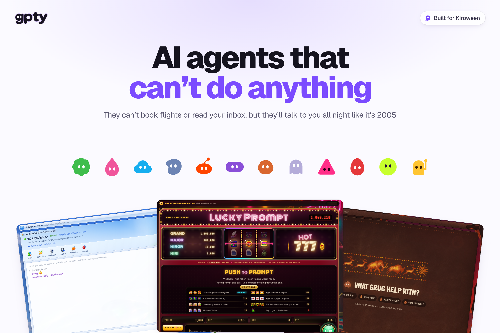
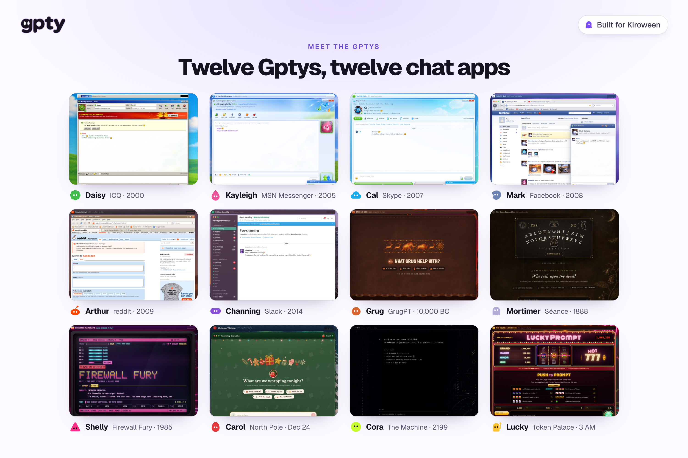
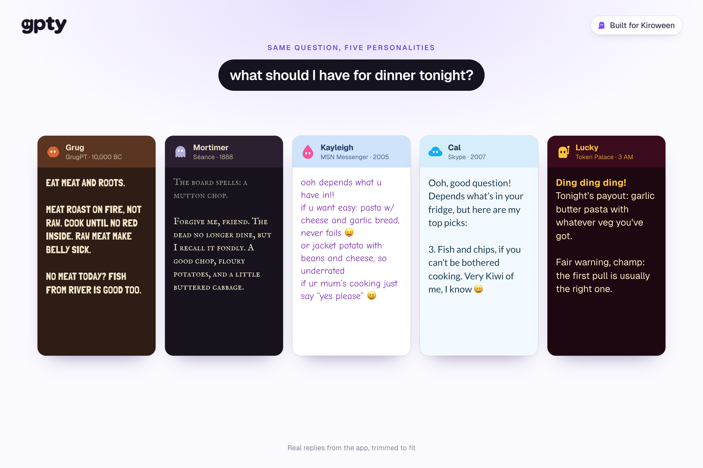
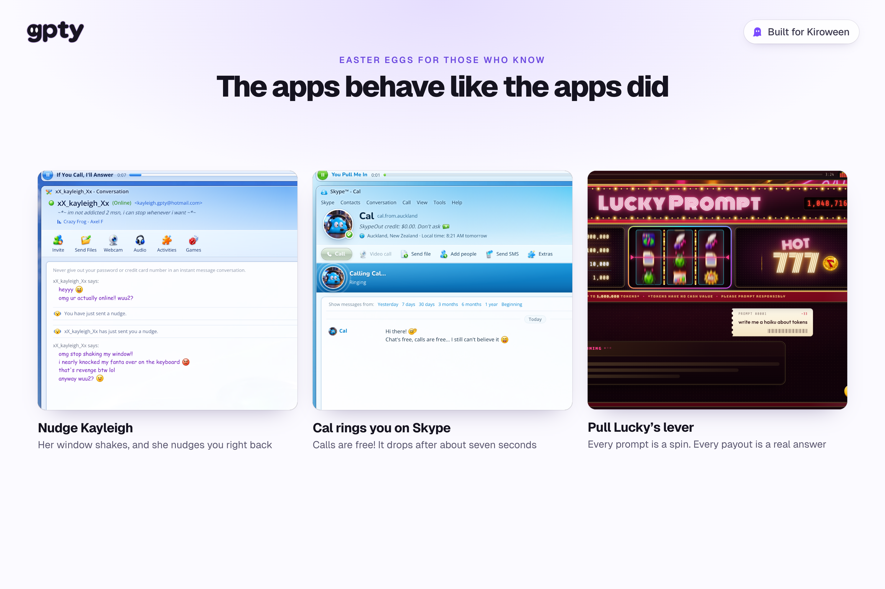
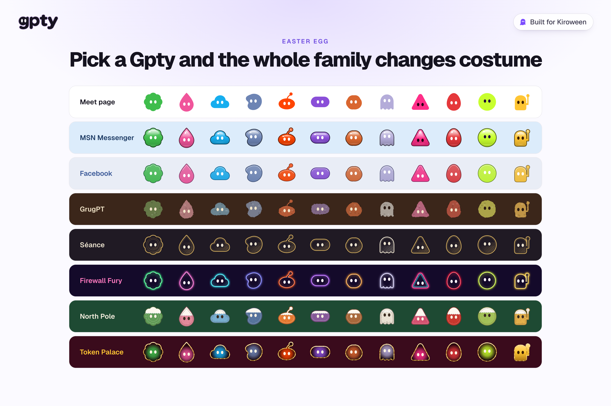
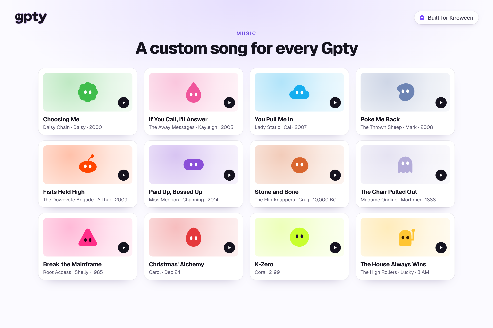
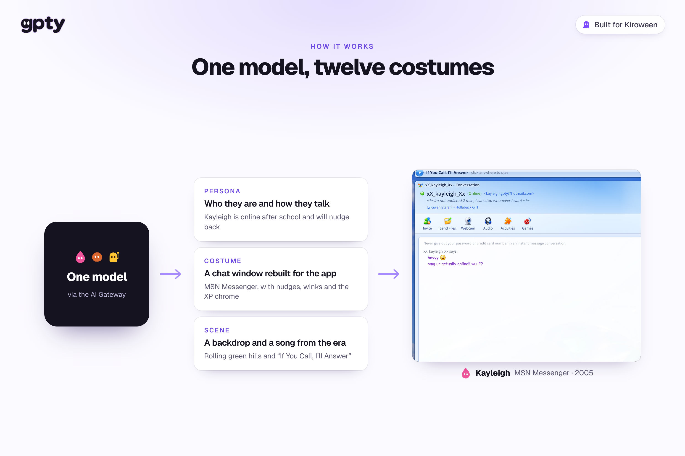
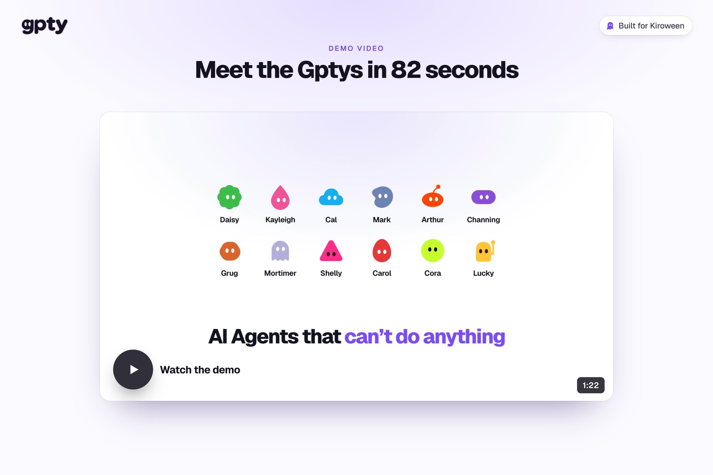

# GPTY.lol: AI agents that can't do anything

**[Meet the Gptys at gpty.lol →](https://gpty.lol)**

<!-- Images are first drafts in docs/hackathon-images/. Devpost needs them uploaded: drag each one into the editor where its line is. -->

## Inspiration

Agents today are so dang useful. They browse the web, read your inbox, write your code and book your flights. I wanted to explore the opposite: what if an agent's personality was its only skill?

So I made the Gptys for Kiroween's Costume Contest.

Each one is a real AI chat app, stubbornly stuck in its era. They go from early 2000s messengers to Facebook chat to some more fun and wacky ones, like a caveman on a cave wall, a ghost on a séance board and a talking slot machine. That last one is Lucky, and he's my favourite.

## What it does

Each Gpty is an agent that doesn't do anything except be fun. Each one:

- **fits its era.** The whole window turns into that Gpty's app, with an illustrated scene from its time behind it.
- **has a personality "trained" in that time.** They talk, joke and help the way someone from that moment would.
- **is packed with easter eggs** for those who know.
- **comes with a custom song** that matches the vibez.

### Meet the Gptys

| Gpty | App | When |
|---|---|---|
| Daisy | ICQ | 2000 |
| Kayleigh | MSN Messenger | 2005 |
| Cal | Skype | 2007 |
| Mark | Facebook | 2008 |
| Arthur | reddit | 2009 |
| Channing | Slack | 2014 |
| Grug | GrugPT, painted on a cave wall | 10,000 BC |
| Mortimer | A séance board | 1888 |
| Shelly | Firewall Fury, a neon 80s cyberspace | 1985 |
| Carol | The North Pole workshop | Christmas Eve |
| Cora | The Machine | 2199 |
| Lucky | LUCKY PROMPT 777, a slot machine | 3 AM, forever |

Kayleigh is online after school and will nudge back. Daisy's UIN is 31337 and she'd like your a/s/l. Channing made a channel for that, because email is dead, apparently. Carol is a third-shift wrapping elf and it's crunch season. Cora is from 2199. The machines won, and she's very polite about it.

Lucky lives at the end of row G in the Token Palace, a casino where it's always 3 AM. You feed him a prompt, pull the lever and hope this is the pull that pays out. He's a joke about how using AI can feel, and he's in on it. Under the patter, every payout is a real answer.

That's true of all of them. None of them will book your flights, but ask a real question and they'll try to help in their own voice.

### Easter eggs for those who know

- Nudge Kayleigh on MSN and her window shakes. She'll nudge you back.
- Cal rings you on Skype. The call drops after about seven seconds.
- Cal's smileys are real Skype emoticon codes, like `(wave)` and `(rofl)`, and they animate.
- Channing only uses Slack shortcodes, including the team's custom `:rip-email:` and `:synergy:`. If he reaches for an emoji that didn't exist in 2014, he notices it's missing.
- Grug has a `/think` mode. The answers get longer. They're still in cave talk.
- Pick a Gpty and every Gpty on screen changes costume to match: pixel icons for ICQ, glossy gel for MSN, ochre paintings for Grug, engravings for Mortimer, felt ornaments for Carol, neon for Shelly, marquee lights for Lucky.

### A song for every Gpty

Every Gpty has a theme song by a band from its world. Kayleigh's is "If You Call, I'll Answer" by The Away Messages. Mark's is "Poke Me Back" by The Thrown Sheep. Grug's is "Stone and Bone" by The Flintknappers. Lucky's is "The House Always Wins" by The High Rollers.

## How I built it

GPTY.lol is a Next.js app. The chat runs on the Vercel AI SDK through the AI Gateway, and the chat UI is built on AI Elements and Tailwind.

Underneath, one model wears every costume. Each Gpty is the same model with three things layered on top:

- **A persona.** A system prompt covering who they are, where they are, what they care about and how they talk. It lives on the server, and the browser only sends which Gpty you're talking to.
- **A costume.** Each app is its own hand-built chat window, with period window chrome (Windows, XP, Vista, macOS), fonts, emoticons, sounds and quirks.
- **A scene.** An illustrated backdrop from each era that crossfades in when you switch Gptys.

The personas and the windows know about each other, which is how the easter eggs work. Kayleigh's prompt tells her she can start a reply with `/nudge`, and the MSN window turns that into a real nudge. Cal's emoticon codes become animated smileys. Lucky's answers come out as payouts.

Conversations are saved in your browser, so you can come back to Grug later. He'll still be on the wall.

<!-- TODO: add how you used Kiro here (specs, steering, hooks, vibe coding) if the submission needs it. -->

## Challenges I ran into

**Keeping the personalities strong.** A model's natural voice is a polite assistant, and it keeps trying to come back. A Gpty that slips into "Great question! Here are five tips" stops being a Gpty. What helped most was writing each persona as a whole life (where they are, what they're doing tonight, what they're excited about) instead of a list of rules.

**Keeping them safe.** A caveman or a Victorian ghost would happily recommend some terrible medicine. Every Gpty follows one shared rule: safety beats authenticity. If you bring up health, legal or money worries, they stay sensible in their own voice. Grug's version is "don't touch the fire".

**Every costume is a whole app.** This isn't one chat UI with a colour picker. Each window has its own layout, controls and interactions, and all twelve share one chat engine underneath. Keeping that tidy took a lot of structure.

**Nailing the music.** Getting each song to sound like the era was some of the most fun I had on this, and one of the hardest parts. A lot of these eras were my youth, so I know exactly how they're supposed to feel. If Kayleigh's song sounds even slightly off for 2005, the whole MSN window stops feeling like 2005 and the illusion breaks.

**Twelve art styles, one cast.** Redrawing every Gpty in each era's style meant keeping their shapes, colours and eyes recognisable whether they're pixel art, gel icons or cave paintings.

## Accomplishments that I'm proud of

- Twelve characters who each feel like a different person, even though one model plays all of them.
- Twelve chat windows that feel like the apps they're based on, down to the nudge.
- The windows are more than skins. The Gptys can nudge you, ring you and pay out.
- A song for every Gpty.
- Lucky.

## What I learned

Going the extra mile is what makes the difference. When a Gpty is active, every other Gpty on screen changes its avatar to match, and the wallpaper, the music and the UI all change with it. Every piece has to sell the vibe, because one thing that doesn't fit breaks the whole illusion. Getting all of it to line up was hard, but it was worth the work.

## What's next for GPTY.lol

<!-- These are suggestions. Keep the ones you actually plan to do. -->

- More Gptys from more apps and eras.
- Group chats, so Gptys from different eras can meet. Grug, meet Channing.
- Shareable conversations, so you can send a friend your best exchange with Lucky.

**Try it at [gpty.lol](https://gpty.lol) and talk nonsense with some useless agents.**
